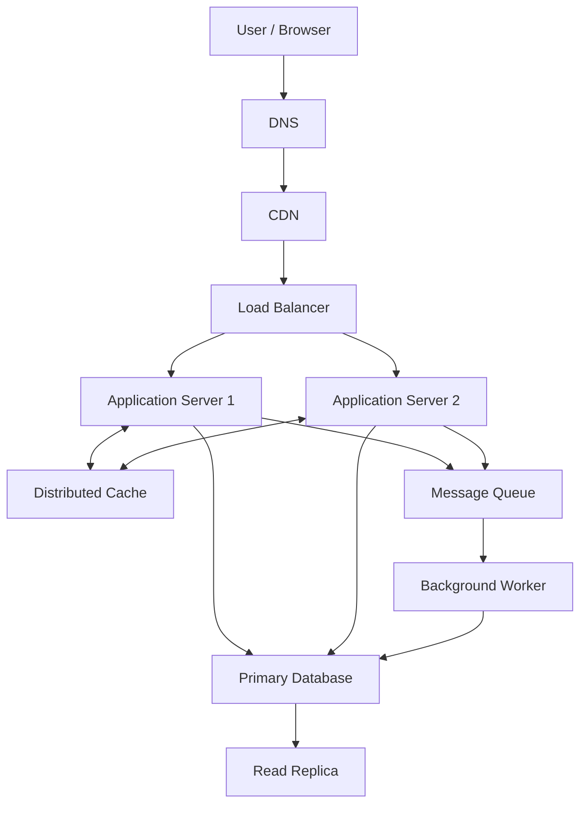

# QuickNotes System Architecture

## 1. Overview

QuickNotes is a web-based note-taking application that allows users to create, read, update, and delete notes. The proposed production architecture separates the frontend, application services, caching, asynchronous processing, and database storage to support growth and reliability.

The current learning project uses a static frontend and JSONPlaceholder. The architecture below describes a proposed production system, not infrastructure already deployed.

## 2. Functional Requirements

- Users can create, view, update, and delete their notes.
- Users can organize notes using tags.
- Users can retrieve and search their notes.
- Users can only access and modify their own notes.
- The system validates user input and reports errors clearly.

## 3. Non-Functional Requirements

- Performance: Common note retrieval requests should respond quickly under normal load.
- Scalability: Application servers can scale horizontally as traffic increases.
- Availability: Redundant services and database failover reduce downtime.
- Security: HTTPS, authentication, authorization, and input validation protect user data.
- Reliability: Database backups and monitoring help recover from failures.
- Maintainability: Separate frontend, API, and data layers make the system easier to update.

## 4. Load Estimates for One Million Users

### Assumptions

- Total registered users: 1,000,000.
- Daily active users: 10% of registered users, or 100,000.
- Each active user reads 50 notes per day.
- Each active user creates one note per day.
- Average stored note size, including basic metadata: approximately 2 KB.
- Peak traffic is estimated at five times the average rate.
- The estimate excludes indexes, backups, replication overhead, and other application data.

### Read requests per second

Daily reads:

`100,000 × 50 = 5,000,000 reads/day`

Average reads per second:

`5,000,000 ÷ 86,400 ≈ 57.9 reads/second`

Estimated peak reads:

`57.9 × 5 ≈ 290 reads/second`

### Write requests per second

Daily writes:

`100,000 × 1 = 100,000 writes/day`

Average writes per second:

`100,000 ÷ 86,400 ≈ 1.16 writes/second`

Estimated peak writes:

`1.16 × 5 ≈ 5.8 writes/second`

### Annual storage

Annual notes created:

`100,000 × 365 = 36,500,000 notes/year`

Estimated annual storage:

`36,500,000 × 2 KB = 73,000,000 KB`

This is approximately 73 GB per year using decimal units, before indexes, backups, replicas, and other overhead.

These are planning estimates based on the stated assumptions, not measured production traffic.

## 5. High-Level Architecture Diagram

## 6. Component Responsibilities

- Client / Browser: Displays the QuickNotes interface and sends API requests.
- DNS: Resolves the application's domain name to its service endpoint.
- CDN: Caches static frontend assets closer to users to reduce latency and origin traffic.
- Load Balancer: Distributes incoming requests across healthy application servers.
- Application Servers 1 and 2: Validate requests, enforce permissions, and implement note-related business logic.
- Distributed Cache: Stores frequently accessed data temporarily to reduce repeated database reads.
- Primary Database: Handles authoritative writes and maintains the main relational data.
- Read Replica: Serves eligible read queries to reduce pressure on the primary database, subject to replication lag.
- Message Queue: Holds background jobs so non-critical work can be processed asynchronously.
- Background Worker: Processes queued jobs, such as notifications or exports, without blocking the user's main request.

## 7. Request Flow: GET /notes

1. The user opens QuickNotes and requests their notes.
2. DNS resolves the application domain.
3. The CDN serves cached static assets when available; API requests continue to the API service.
4. The load balancer forwards the API request to a healthy application server.
5. The server authenticates the user and checks authorization.
6. The server checks the distributed cache for the user's notes.
7. If suitable cached data is unavailable, the server queries the database, using the read replica where appropriate.
8. The server returns the notes as JSON with an HTTP `200 OK` response.
9. The client displays the notes.

## 8. Request Flow: POST /notes

1. The user submits a note through the frontend.
2. The client sends a `POST /api/v1/notes` request with a JSON body over HTTPS.
3. The load balancer forwards the request to a healthy application server.
4. The server authenticates the user and validates the title and body.
5. The server writes the new note to the primary database.
6. After the database transaction succeeds, the server invalidates or updates relevant cached data.
7. The server returns the created note with HTTP `201 Created`.
8. Any non-critical follow-up work is placed on the message queue for background processing.

## 9. Architecture Trade-Offs

### Cache performance vs. data freshness

Caching improves read performance and reduces database load, but cached notes can become stale. Cache invalidation or short expiration times help balance performance with freshness.

### Read replicas vs. consistency

Read replicas distribute read traffic, but replication lag may cause recently updated notes to appear outdated. Read-after-write requests can be sent to the primary database when fresh data is required.

### Synchronous vs. asynchronous processing

Processing notifications and exports through a queue keeps the main request responsive. However, background jobs may be delayed and require retries, monitoring, and duplicate-processing protection.

### Horizontal scaling vs. operational complexity

Multiple application servers improve capacity and resilience, but require health checks, monitoring, and consistent configuration.

## 10. Avoiding Single Points of Failure

- Deploy application servers across separate instances or availability zones.
- Use redundant load balancers or a managed highly available load-balancing service.
- Use a distributed cache with replication or a managed highly available cache.
- Configure database backups, replication, monitoring, and automatic or documented failover.
-